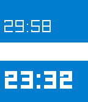

<!-- Generated by scripts/update_app_directory.py: do not edit by hand -->
[← All Pebble Developers](../developers.md)

# Leo Liang

*1 app · Last updated 2026-10-11 · [About these lists](../about-app-lists.md)*

Links: [Rebble App Store](https://apps.rebble.io/en_US/developer/5313f1b743d9607ef00003c7/1) · [GitHub (aleung)](https://github.com/aleung)

<h2 class="app-name" id="app-5a1add180dfc32dba0000dd3"><a href="https://apps.rebble.io/en_US/application/5a1add180dfc32dba0000dd3">Rest Time</a> v2.2</h2>
<a class="app-source" href="https://github.com/aleung/rest-time" title="Source code" data-search-exclude>View source</a>

App

No licence Released 2017-11-26 Updated 2017-11-26 Rebble App Store

Runs on: Time 2, Pebble 2 Duo, Pebble 2, Time, Classic

A Pebble app that reminds you to rest. Two clock displays: the bottom shows the current time, the top shows a timer counting down the time until your next break. Controls Up Button: Reset the…

