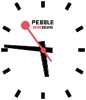

<!-- Generated by scripts/update_app_directory.py: do not edit by hand -->
[← All Pebble Developers](../developers.md)

# Leo Lin

*1 watchface · Last updated 2026-10-11 · [About these lists](../about-app-lists.md)*

Links: [Pebble App Store](https://apps.repebble.com/apps/dev/leo-lin_547e76babca84b200e0000f2) · [GitHub (sillyleo)](https://github.com/sillyleo)

<h2 class="app-name" id="app-5799bedf1482cd673b000152"><a href="https://apps.repebble.com/5799bedf1482cd673b000152">Swiss Square</a> v1.3</h2>
<a class="app-source" href="https://github.com/sillyleo/SwissSquare" title="Source code" data-search-exclude>View source</a>

Watchface

Released 2016-07-28 Updated 2016-10-04

Runs on: Time 2, Pebble 2 Duo, Pebble 2, Time, Classic

Inspired by the simple design of Official Swiss Railways Watch. Made it square, big, easier to read. It looks best with the white background. Original work by Johnny Lim&#x27;s Mondaine watchface.

