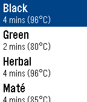

<!-- Generated by scripts/update_app_directory.py: do not edit by hand -->
[← All Pebble Developers](../developers.md)

# Léomike Hébert

*1 app · Last updated 2026-10-12 · [About these lists](../about-app-lists.md)*

Links: [Pebble App Store](https://apps.repebble.com/apps/dev/l-omike-h-bert_5675f8f8e85481dd48000076) · [GitHub (leomike)](https://github.com/leomike) · [Website (leomike.com)](https://leomike.com)

<h2 class="app-name" id="app-56bcec5ea4f2533892000021"><a href="https://apps.repebble.com/56bcec5ea4f2533892000021">Tea&#x27;s Ready</a> v0.8</h2>
<a class="app-source" href="https://github.com/leomike/tea" title="Source code" data-search-exclude>View source</a>

App

Released 2016-02-11 Updated 2016-02-25

Runs on: Round 2, Time 2, Pebble 2 Duo, Pebble 2, Time Round, Time, Classic

Ever forgot to take the tea bag out of your cup? Wondered what temperature the water should be at for green tea? What is the recommended steeping time for rooibos tea? Well this is your day, I…

