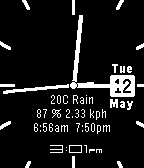

<!-- Generated by scripts/update_app_directory.py: do not edit by hand -->
[← All Pebble Developers](../developers.md)

# Leon Felipe

*1 watchface · Last updated 2026-10-12 · [About these lists](../about-app-lists.md)*

Links: [Pebble App Store](https://apps.repebble.com/apps/dev/leon-felipe_550f9acac0455737850000b5) · [GitHub (leonlipe)](https://github.com/leonlipe) · [Website (redleon.net)](http://www.redleon.net)

<h2 class="app-name" id="app-55525cc271c40dcfc7000071"><a href="https://apps.repebble.com/55525cc271c40dcfc7000071">Analog Simple Thin</a> v1.11</h2>
<a class="app-source" href="https://github.com/leonlipe/thinwithnumbers.git" title="Source code" data-search-exclude>View source</a>

Watchface

Released 2015-05-12 Updated 2015-05-15

Runs on: Time 2, Pebble 2 Duo, Pebble 2, Time, Classic

A simple Analog Watch face You can show: - Time in digital - Temperature, conditions - Humidity, wind speed - Sunrise and sunset hours - Shows the date Plus, size for the hands, style of the…

