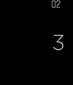
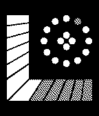

<!-- Generated by scripts/update_app_directory.py: do not edit by hand -->
[← All Pebble Developers](../developers.md)

# leovander

*3 watchfaces · Last updated 2026-10-12 · [About these lists](../about-app-lists.md)*

Links: [Pebble App Store](https://apps.repebble.com/apps/dev/leovander_54ef9c482e6a47d04c0000d3) · [GitHub (leovander)](https://github.com/leovander)

<button type="button" data-filter="all" aria-pressed="true">All 3</button><button type="button" data-filter="watchface" aria-pressed="false">Watchfaces 3</button><button type="button" data-filter="watchapp" aria-pressed="false" disabled>Apps 0</button>

<label class="dev-sort">Sort by <select><option value="updated">Recently updated</option><option value="released">Newest release</option><option value="title">A–Z</option></select></label>

<h2 class="app-name" id="app-55543f0864e9b738860000eb"><a href="https://apps.repebble.com/55543f0864e9b738860000eb">Dani</a> v1.8</h2>
<a class="app-source" href="https://github.com/leovander/Dani/tree/master" title="Source code" data-search-exclude>View source</a>

Watchface

Released 2015-05-14 Updated 2015-06-05

Runs on: Time 2, Pebble 2 Duo, Pebble 2, Time, Classic

- Added Config screen - Option to invert background and text (Will be adding color options for Time) - Option for larger text Suggestions? @theleovander Concept submitted by /u/danilouis on reddit.

<h2 class="app-name" id="app-554aa11eee68650e870000af"><a href="https://apps.repebble.com/554aa11eee68650e870000af">Vice</a> v1.1</h2>
<a class="app-source" href="https://github.com/leovander/vice" title="Source code" data-search-exclude>View source</a>

Watchface

Released 2015-05-06 Updated 2015-05-11

Runs on: Time 2, Time

Vice is inspired from the colors of Miami Vice logo and the awesome 80&#x27;s.

<h2 class="app-name" id="app-554960c92cfbfca8a20000eb"><a href="https://apps.repebble.com/554960c92cfbfca8a20000eb">Kyokusen JS</a> v0.1</h2>
<a class="app-source" href="https://github.com/leovander/Kyokusen-JS" title="Source code" data-search-exclude>View source</a>

Watchface

Released 2015-05-06 Updated 2015-05-06

Runs on: Time 2, Pebble 2 Duo, Pebble 2, Time, Classic

Watchface inspired by Tokyoflash Japan&#x27;s Kyokusen Watch. Be wary, made with PebbleJS not knowing C is preferred. May fail after awhile but you can refresh the face.

