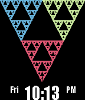
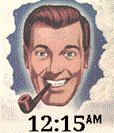
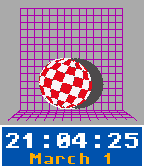

<!-- Generated by scripts/update_app_directory.py: do not edit by hand -->
[← All Pebble Developers](../developers.md)

# lesliesbird

*3 watchfaces · Last updated 2026-10-11 · [About these lists](../about-app-lists.md)*

Links: [Pebble App Store](https://apps.repebble.com/apps/dev/lesliesbird_52ed13ae077dd4f458000033) · [GitHub (lesliesbird)](https://github.com/lesliesbird)

<button type="button" data-filter="all" aria-pressed="true">All 3</button><button type="button" data-filter="watchface" aria-pressed="false">Watchfaces 3</button><button type="button" data-filter="watchapp" aria-pressed="false" disabled>Apps 0</button>

<label class="dev-sort">Sort by <select><option value="updated">Recently updated</option><option value="released">Newest release</option><option value="title">A–Z</option></select></label>

<h2 class="app-name" id="app-55219f0dd7356c3e2e00006b"><a href="https://apps.repebble.com/55219f0dd7356c3e2e00006b">Chaos</a> v1.6</h2>
<a class="app-source" href="https://github.com/lesliesbird/Chaos" title="Source code" data-search-exclude>View source</a>

Watchface

Released 2015-04-05 Updated 2017-01-27

Runs on: Round 2, Time 2, Pebble 2 Duo, Pebble 2, Time Round, Time, Classic

An exercise in plotting fractal equations. Displays either Sierpinski Triangle, Sierpinski Carpet, Henon Attractor, Julia Set or Mandlebrot Set plotted by a random algorithm. A new pattern is…

<h2 class="app-name" id="app-52eea1c515f7074e50000002"><a href="https://apps.repebble.com/52eea1c515f7074e50000002">DobbsHead</a> v3.4</h2>
<a class="app-source" href="https://github.com/lesliesbird/DobbsHead" title="Source code" data-search-exclude>View source</a>

Watchface

Released 2014-02-02 Updated 2016-11-29

Runs on: Round 2, Time 2, Pebble 2 Duo, Pebble 2, Time Round, Time, Classic

Remind yourself that it&#x27;s time for some Slack when you look down to see the smiling face of J.R. &quot;Bob&quot; Dobbs! As you watch, random images will flash on the watchface at random intervals. Or maybe…

<h2 class="app-name" id="app-52ee9fd7e75bd2c34300003c"><a href="https://apps.repebble.com/52ee9fd7e75bd2c34300003c">Amiga Boing</a> v3.6</h2>
<a class="app-source" href="https://github.com/lesliesbird/AmigaBoing" title="Source code" data-search-exclude>View source</a>

Watchface

Released 2014-02-02 Updated 2016-11-28

Runs on: Round 2, Time 2, Pebble 2 Duo, Pebble 2, Time Round, Time, Classic

Recreates the original Boing Ball demo from the Amiga computer. The ball rotates and bounces around the screen, while the time readout is using the original Amiga Topaz font. Shake or tap the…

