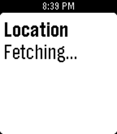

<!-- Generated by scripts/update_app_directory.py: do not edit by hand -->
[← All Pebble Developers](../developers.md)

# Lesosoftware

*1 app · Last updated 2026-10-11 · [About these lists](../about-app-lists.md)*

Links: [Rebble App Store](https://apps.rebble.io/en_US/developer/5f3ee4ac3dd310431df1c5e5/1) · [GitHub (leso-kn)](https://github.com/leso-kn)

<h2 class="app-name" id="app-5f3ee4ad3dd310431df1c5e7"><a href="https://apps.rebble.io/en_US/application/5f3ee4ad3dd310431df1c5e7">Locator</a> v1.2</h2>
<a class="app-source" href="https://github.com/leso-kn/Pebble.Locator" title="Source code" data-search-exclude>View source</a>

App

Released 2020-08-20 Updated 2023-06-27 Rebble App Store

Runs on: Round 2, Time 2, Pebble 2 Duo, Pebble 2, Time Round, Time, Classic

This app simply displays the user&#x27;s current location! Credits go to Campion Fellin. This is a continuation of his work over at…

