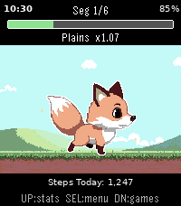

<!-- Generated by scripts/update_app_directory.py: do not edit by hand -->
[← All Pebble Developers](../developers.md)

# Levonn

*1 watchface and 1 app · Last updated 2026-10-11 · [About these lists](../about-app-lists.md)*

Links: [Pebble App Store](https://apps.repebble.com/apps/dev/levonn_f316bd30e30eb999711b5614) · [GitHub (levonn-dev)](https://github.com/levonn-dev)

<button type="button" data-filter="all" aria-pressed="true">All 2</button><button type="button" data-filter="watchface" aria-pressed="false">Watchfaces 1</button><button type="button" data-filter="watchapp" aria-pressed="false">Apps 1</button>

<label class="dev-sort">Sort by <select><option value="updated">Recently updated</option><option value="released">Newest release</option><option value="title">A–Z</option></select></label>

<h2 class="app-name" id="app-5841886baf734898822e2899"><a href="https://apps.repebble.com/5841886baf734898822e2899">Fox Weather</a> v1.0.0</h2>
<a class="app-source" href="https://github.com/levonn-dev/pebble-adventure-wf" title="Source code" data-search-exclude>View source</a>

Watchface

Released 2026-05-26 Updated 2026-05-26

Runs on: Time 2, Pebble 2 Duo

A Pebble watchface where the sky follows your weather and a pixel fox keeps you company. The background changes with the current conditions, a fox sits (or walks) on the ground, and the time…

<h2 class="app-name" id="app-d50eaec84a5e410298a3d2c7"><a href="https://apps.repebble.com/d50eaec84a5e410298a3d2c7">Pebble Adventure</a> v1.1.0</h2>
<a class="app-source" href="https://github.com/levonn-dev/pebble-adventure" title="Source code" data-search-exclude>View source</a>

App

Released 2026-04-15 Updated 2026-05-21

Runs on: Time 2, Pebble 2 Duo

# Pebble Adventure ## Walk further. Level up. Explore the world. One step at a time. --- ## The Game Born from a love of Chao Adventure, Tamagotchi, and Ragnarok Online, Pebble Adventure is a…

