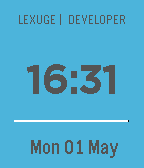

<!-- Generated by scripts/update_app_directory.py: do not edit by hand -->
[← All Pebble Developers](../developers.md)

# LEXUGE

*1 watchface · Last updated 2026-10-12 · [About these lists](../about-app-lists.md)*

Links: [Rebble App Store](https://apps.rebble.io/en_US/developer/59040cbb6ca387f83d000242/1) · [GitHub (LEXUGE)](https://github.com/LEXUGE) · [Website (lexuge.github.io)](https://lexuge.github.io)

<h2 class="app-name" id="app-590431830dfc328c360006ce"><a href="https://apps.rebble.io/en_US/application/590431830dfc328c360006ce">lexuge</a> v1.3</h2>
<a class="app-source" href="https://github.com/LEXUGE/lexuge-face" title="Source code" data-search-exclude>View source</a>

Watchface

GPL-3.0 Released 2017-04-29 Updated 2017-05-04 Rebble App Store

Runs on: Round 2, Time 2, Pebble 2 Duo, Pebble 2, Time Round, Time, Classic

A LEXUGE&#x27;s opensource watchface Simple and modern watchface. See the time as digital. See the battery bar as the line. The source code on github:https://github.com/LEXUGE/lexuge-face

