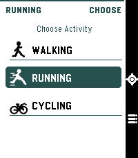
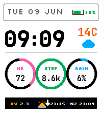

<!-- Generated by scripts/update_app_directory.py: do not edit by hand -->
[← All Pebble Developers](../developers.md)

# Liam Cordelle

*1 watchface and 1 app · Last updated 2026-10-12 · [About these lists](../about-app-lists.md)*

Links: [Pebble App Store](https://apps.repebble.com/apps/dev/liam-cordelle_e31645c88f617059803cfa71) · [GitHub (LiamCordelle)](https://github.com/LiamCordelle)

<button type="button" data-filter="all" aria-pressed="true">All 2</button><button type="button" data-filter="watchface" aria-pressed="false">Watchfaces 1</button><button type="button" data-filter="watchapp" aria-pressed="false">Apps 1</button>

<label class="dev-sort">Sort by <select><option value="updated">Recently updated</option><option value="released">Newest release</option><option value="title">A–Z</option></select></label>

<h2 class="app-name" id="app-81fc38ce91e5491d91b72840"><a href="https://apps.repebble.com/81fc38ce91e5491d91b72840">Pacelet</a> v0.6.1</h2>
<a class="app-source" href="https://github.com/LiamCordelle/pacelet" title="Source code" data-search-exclude>View source</a>

App

MIT Released 2026-06-17 Updated 2026-09-22

Runs on: Time 2

A simple activity tracker, using phone GPS

<h2 class="app-name" id="app-6e750c03f2d5418787ff3390"><a href="https://apps.repebble.com/6e750c03f2d5418787ff3390">Signal Deck</a> v1.2.7</h2>
<a class="app-source" href="https://github.com/LiamCordelle/signal-deck" title="Source code" data-search-exclude>View source</a>

Watchface

MIT Released 2026-06-09 Updated 2026-07-23

Runs on: Time 2

A configurable light/dark flight-deck watchface with weather, health gauges, world clock, and crisp pixel typography.

