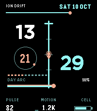

<!-- Generated by scripts/update_app_directory.py: do not edit by hand -->
[← All Pebble Developers](../developers.md)

# LifeSim

*1 watchface · Last updated 2026-10-12 · [About these lists](../about-app-lists.md)*

Links: [Pebble App Store](https://apps.repebble.com/apps/dev/lifesim_b0d2774b46ac6e81ee26a0d8) · [GitHub (leifenberg-eyal)](https://github.com/leifenberg-eyal) · [Website (kzl.io)](https://kzl.io/iondrift)

<h2 class="app-name" id="app-1683c3912c4a4292a4b4f3b1"><a href="https://apps.repebble.com/1683c3912c4a4292a4b4f3b1">Ion Drift</a> v1.2.0</h2>
<a class="app-source" href="https://github.com/leifenberg-eyal/ion-drift" title="Source code" data-search-exclude>View source</a>

Watchface

Released 2026-10-10 Updated 2026-10-10

Runs on: Time 2

Ion Drift turns the Pebble Time 2 into a compact split-time instrument. Hours and minutes occupy opposing fields around a luminous center spine, keeping the time readable while live telemetry…

