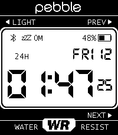

<!-- Generated by scripts/update_app_directory.py: do not edit by hand -->
[← All Pebble Developers](../developers.md)

# lightrush

*1 watchface · Last updated 2026-10-11 · [About these lists](../about-app-lists.md)*

Links: [Pebble App Store](https://apps.repebble.com/apps/dev/lightrush_a629091196f5c43f3bece7ef) · [Codeberg (lightrush)](https://codeberg.org/lightrush)

<h2 class="app-name" id="app-9c38203a46aa4feebba82648"><a href="https://apps.repebble.com/9c38203a46aa4feebba82648">91 Dub v5</a> v5.5.4</h2>
<a class="app-source" href="https://codeberg.org/lightrush/91-dub-v5" title="Source code" data-search-exclude>View source</a>

Watchface · <a href="https://forum.rebble.io/t/1060" title="Discuss this app on the Rebble forum" data-search-exclude>Forum thread</a>

Released 2026-06-10 Updated 2026-07-08

Runs on: Time 2

91 Dub v5 A fork of the great [91 Dub v4.0](https://github.com/orviwan/91-dub-4.0) watchface by Orviwan, rebuilt for the Pebble Time 2 (Emery). - Optimized for the new PT2 display resolution with…

