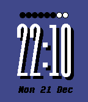

<!-- Generated by scripts/update_app_directory.py: do not edit by hand -->
[← All Pebble Developers](../developers.md)

# linearcircles

*2 watchfaces · Last updated 2026-10-11 · [About these lists](../about-app-lists.md)*

Links: [Pebble App Store](https://apps.repebble.com/apps/dev/linearcircles_566d8849925d554c8400002d) · [GitHub (kendra-w)](https://github.com/kendra-w)

<button type="button" data-filter="all" aria-pressed="true">All 2</button><button type="button" data-filter="watchface" aria-pressed="false">Watchfaces 2</button><button type="button" data-filter="watchapp" aria-pressed="false" disabled>Apps 0</button>

<label class="dev-sort">Sort by <select><option value="updated">Recently updated</option><option value="released">Newest release</option><option value="title">A–Z</option></select></label>

<h2 class="app-name" id="app-5678bd5cbdb5f03021000067"><a href="https://apps.repebble.com/5678bd5cbdb5f03021000067">IndigoPop</a> v1.0</h2>
<a class="app-source" href="https://drive.google.com/folderview?id=0B8NGi9DsVuvpci1acXV0VEVBRDA&amp;usp=sharing" title="Source code" data-search-exclude>View source</a>

Watchface

Released 2015-12-22 Updated 2015-12-22

Runs on: Round 2, Time 2, Time Round, Time

This watchface displays the digital time with a shadow to make it pop! Your watch&#x27;s battery level is displayed above with a row of circles, and the date is located below the time. Compatible with…

<h2 class="app-name" id="app-566d8c5c51e7217e14000039"><a href="https://apps.repebble.com/566d8c5c51e7217e14000039">HeartClock</a> v1.0</h2>
<a class="app-source" href="https://github.com/kendra-w/HeartClock" title="Source code" data-search-exclude>View source</a>

Watchface

Released 2015-12-13 Updated 2015-12-13

Runs on: Round 2, Time 2, Time Round, Time

This watchface displays the time, date, and a neat battery meter of heart lives, like in a video game. It&#x27;s compatible with Basalt (Time and Time Steel) or Chalk (Time Round).

