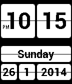

<!-- Generated by scripts/update_app_directory.py: do not edit by hand -->
[← All Pebble Developers](../developers.md)

# lingen.me

*1 watchface · Last updated 2026-10-12 · [About these lists](../about-app-lists.md)*

Links: [Pebble App Store](https://apps.repebble.com/apps/dev/lingen-me_52cb28766e5f70c11500005f)

<h2 class="app-name" id="app-52cb29b36e5f7044c7000065"><a href="https://apps.repebble.com/52cb29b36e5f7044c7000065">Retro Clock</a> v2.0.1</h2>
<a class="app-source" href="https://bitbucket.org/lingen/retroclock-pebble" title="Source code" data-search-exclude>View source</a>

Watchface

Released 2014-01-06 Updated 2014-01-26

Runs on: Time 2, Pebble 2 Duo, Pebble 2, Time, Classic

Pebble watchface based on my popular Retro Clock widget for Android. It provides a clean display of time and date. The date format can be changed in the settings. Special thanks to Max Bäumle for…

