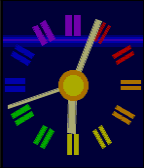
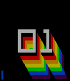
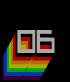
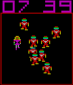
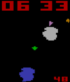
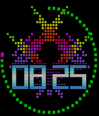
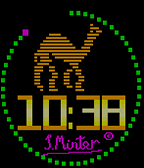

<!-- Generated by scripts/update_app_directory.py: do not edit by hand -->
[← All Pebble Developers](../developers.md)

# Llamasoft

*7 watchfaces · Last updated 2026-10-12 · [About these lists](../about-app-lists.md)*

Links: [Pebble App Store](https://apps.repebble.com/apps/dev/llamasoft_5587e2694fa1ea20620000ba) · [GitHub (an-ox)](https://github.com/an-ox) · [Website (llamasoft.co.uk)](http://llamasoft.co.uk)

<button type="button" data-filter="all" aria-pressed="true">All 7</button><button type="button" data-filter="watchface" aria-pressed="false">Watchfaces 7</button><button type="button" data-filter="watchapp" aria-pressed="false" disabled>Apps 0</button>

<label class="dev-sort">Sort by <select><option value="updated">Recently updated</option><option value="released">Newest release</option><option value="title">A–Z</option></select></label>

<h2 class="app-name" id="app-55994a75a3e6689532000038"><a href="https://apps.repebble.com/55994a75a3e6689532000038">BBC</a> v1.04</h2>
<a class="app-source" href="https://github.com/an-ox/bbc" title="Source code" data-search-exclude>View source</a>

Watchface

No licence Released 2015-07-05 Updated 2015-08-09

Runs on: Time 2, Pebble 2 Duo, Pebble 2, Time, Classic

Watchfaces based on BBC continuity clocks from various eras 1953-1991. Extended colour mode available that incorporates battery level information into the visual design of each face.

<h2 class="app-name" id="app-558fe9a96dba2d7820000039"><a href="https://apps.repebble.com/558fe9a96dba2d7820000039">minimal x</a> v1.0</h2>
<a class="app-source" href="https://github.com/an-ox/minimal-x" title="Source code" data-search-exclude>View source</a>

Watchface

No licence Released 2015-06-28 Updated 2015-06-28

Runs on: Time 2, Time

This is a slightly extended version of my Minimal face. I added a single indicator at the bottom that shows both battery level and BT status (if the indicator is blue it&#x27;s connected, if it&#x27;s red…

<h2 class="app-name" id="app-558ee0ee1b715219970000a4"><a href="https://apps.repebble.com/558ee0ee1b715219970000a4">minimal</a> v1.0</h2>
<a class="app-source" href="https://github.com/an-ox/minimal" title="Source code" data-search-exclude>View source</a>

Watchface

No licence Released 2015-06-27 Updated 2015-06-27

Runs on: Time 2, Time

Here&#x27;s a minimal one from me. It&#x27;s designed to be very battery friendly (once per minute update) and to combine digital and analogue style reading in one face - the digits in the middle are the…

<h2 class="app-name" id="app-558afab8b5799abef40000e9"><a href="https://apps.repebble.com/558afab8b5799abef40000e9">Roby</a> v1.0</h2>
<a class="app-source" href="https://github.com/an-ox/roby" title="Source code" data-search-exclude>View source</a>

Watchface

No licence Released 2015-06-24 Updated 2015-06-24

Runs on: Time 2, Time

Watchface based on the Robotron arcade game

<h2 class="app-name" id="app-55899c20ef446d0ed80000e7"><a href="https://apps.repebble.com/55899c20ef446d0ed80000e7">VCSteroids</a> v1.0</h2>
<a class="app-source" href="https://github.com/an-ox/vcsteroids" title="Source code" data-search-exclude>View source</a>

Watchface

No licence Released 2015-06-23 Updated 2015-06-23

Runs on: Time 2, Time

Watchface based on the old VCS Asteroids game.

<h2 class="app-name" id="app-558862daedfc5aa9f4000009"><a href="https://apps.repebble.com/558862daedfc5aa9f4000009">Psychedelia</a> v1.0</h2>
<a class="app-source" href="https://github.com/an-ox/Psychedelia-watchface" title="Source code" data-search-exclude>View source</a>

Watchface

No licence Released 2015-06-22 Updated 2015-06-22

Runs on: Time 2, Time

Runs the C64 &quot;Psychedelia&quot; lightsynth on a Pebble Time.

<h2 class="app-name" id="app-558857a641241a58540000ff"><a href="https://apps.repebble.com/558857a641241a58540000ff">C64 sprites</a> v1.2</h2>
<a class="app-source" href="https://github.com/an-ox/C64-sprites-watchface" title="Source code" data-search-exclude>View source</a>

Watchface

No licence Released 2015-06-22 Updated 2015-06-22

Runs on: Time 2, Time

Watchface displaying animations from Llamasoft C64 games.

