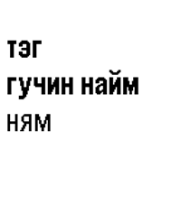

<!-- Generated by scripts/update_app_directory.py: do not edit by hand -->
[← All Pebble Developers](../developers.md)

# lmo0731

*1 watchface · Last updated 2026-10-11 · [About these lists](../about-app-lists.md)*

Links: [Rebble App Store](https://apps.rebble.io/en_US/developer/59cd4b8a461a8d8fd1002118/1) · [GitHub (lmo0731)](https://github.com/lmo0731)

<h2 class="app-name" id="app-59eb79ad461a8d72e800037c"><a href="https://apps.rebble.io/en_US/application/59eb79ad461a8d72e800037c">Mongol Tsag</a> v1.0</h2>
<a class="app-source" href="https://github.com/lmo0731/PebbleMongolTsag" title="Source code" data-search-exclude>View source</a>

Watchface

Released 2017-10-21 Updated 2017-10-21 Rebble App Store

Runs on: Round 2, Time 2, Pebble 2 Duo, Pebble 2, Time Round, Time

Shows clock as mongolian

