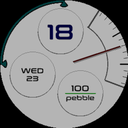

<!-- Generated by scripts/update_app_directory.py: do not edit by hand -->
[← All Pebble Developers](../developers.md)

# lnbot

*1 watchface · Last updated 2026-10-12 · [About these lists](../about-app-lists.md)*

Links: [Rebble App Store](https://apps.rebble.io/en_US/developer/6abe8fcaaef3d70009c6ff7b/1) · [GitHub (lnbot)](https://github.com/lnbot)

<h2 class="app-name" id="app-6abe92fb5af6a30009f371ac"><a href="https://apps.rebble.io/en_US/application/6abe92fb5af6a30009f371ac">Arc View</a> v1.0.1</h2>
<a class="app-source" href="https://github.com/lnbot/arc-view" title="Source code" data-search-exclude>View source</a>

Watchface · <a href="https://forum.rebble.io/t/1395" title="Discuss this app on the Rebble forum" data-search-exclude>Forum thread</a>

Released 2026-10-01 Updated 2026-10-01 Rebble App Store

Runs on: Round 2, Time Round

Watchface with a minute hand and digital hour. Also features optional orbiting complications, sub-minute hand movement, and a minute tick visibility window. With the optional Android companion…

