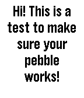

<!-- Generated by scripts/update_app_directory.py: do not edit by hand -->
[← All Pebble Developers](../developers.md)

# LochRED

*2 watchfaces and 1 app · Last updated 2026-10-11 · [About these lists](../about-app-lists.md)*

Links: [Rebble App Store](https://apps.rebble.io/en_US/developer/5926fa58b67f9f43f800046c/1) · [GitHub (LochRED)](https://github.com/LochRED)

<button type="button" data-filter="all" aria-pressed="true">All 3</button><button type="button" data-filter="watchface" aria-pressed="false">Watchfaces 2</button><button type="button" data-filter="watchapp" aria-pressed="false">Apps 1</button>

<label class="dev-sort">Sort by <select><option value="updated">Recently updated</option><option value="released">Newest release</option><option value="title">A–Z</option></select></label>

<h2 class="app-name" id="app-5a3d63490dfc321afc000024"><a href="https://apps.rebble.io/en_US/application/5a3d63490dfc321afc000024">Actual Tic Toc Pink</a> v1.0</h2>
<a class="app-source" href="https://github.com/LochRED/Attp" title="Source code" data-search-exclude>View source</a>

Watchface

No licence Released 2017-12-22 Updated 2017-12-22 Rebble App Store

Runs on: Round 2, Time 2, Time Round, Time

An Actual Tic Toc pink watchface for Pebble watches. (The difference between this and Actual Tic Toc is this version has pink hands.) If you like this, Send me some Bitcoins! Wallet ID…

<h2 class="app-name" id="app-5a33009e461a8d2dd000128f"><a href="https://apps.rebble.io/en_US/application/5a33009e461a8d2dd000128f">Actual Tic Toc</a> v1.0</h2>
<a class="app-source" href="https://github.com/LochRED/ActTTAlt" title="Source code" data-search-exclude>View source</a>

Watchface

No licence Released 2017-12-14 Updated 2017-12-14 Rebble App Store

Runs on: Round 2, Time 2, Time Round, Time

An actual tic toc watchface for pebble watches. If you like this, Send me some Bitcoins! Wallet ID 16VyPy2uBHp3QYHMTJbKz7si8HxudpJkgv

<h2 class="app-name" id="app-5a302ef50dfc323bd0003987"><a href="https://apps.rebble.io/en_US/application/5a302ef50dfc323bd0003987">Hello There!</a> v1.0</h2>
<a class="app-source" href="https://github.com/LochRED/ht" title="Source code" data-search-exclude>View source</a>

App

No licence Released 2017-12-12 Updated 2017-12-12 Rebble App Store

Runs on: Round 2, Time 2, Pebble 2 Duo, Pebble 2, Time Round, Time, Classic

This is an app that I made (With the help of a Cloud Pebble Design template.) It displays a message. That&#x27;s about it. (BTW, 13 year old developer here. This is my first app :). ) If you like this…

