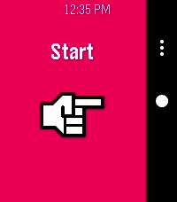
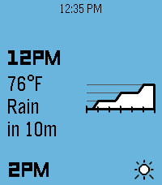
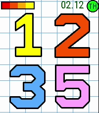
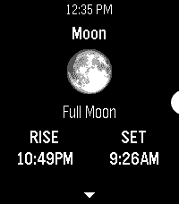

<!-- Generated by scripts/update_app_directory.py: do not edit by hand -->
[← All Pebble Developers](../developers.md)

# Logan Head

*2 watchfaces and 3 apps · Last updated 2026-10-11 · [About these lists](../about-app-lists.md)*

Links: [Pebble App Store](https://apps.repebble.com/apps/dev/logan-head_5c26a4f727cdec0001c0500d) · [GitHub (erlog135)](https://github.com/erlog135) · [Website (loganhead.net)](https://loganhead.net)

<button type="button" data-filter="all" aria-pressed="true">All 5</button><button type="button" data-filter="watchface" aria-pressed="false">Watchfaces 2</button><button type="button" data-filter="watchapp" aria-pressed="false">Apps 3</button>

<label class="dev-sort">Sort by <select><option value="updated">Recently updated</option><option value="released">Newest release</option><option value="title">A–Z</option></select></label>

<h2 class="app-name" id="app-a71b955ceef1469fbae23373"><a href="https://apps.repebble.com/a71b955ceef1469fbae23373">Treble</a> v1.1.0</h2>
<a class="app-source" href="https://github.com/erlog135/treble" title="Source code" data-search-exclude>View source</a>

App · <a href="https://forum.rebble.io/t/903" title="Discuss this app on the Rebble forum" data-search-exclude>Forum thread</a>

Released 2026-04-15 Updated 2026-09-18

Runs on: Round 2, Time 2, Pebble 2 Duo, Pebble 2, Time Round, Time, Classic

IMPORTANT: Version 1.0.0 of the Android app will stop working before October 2026. Update it to 1.1.0 before then, or you won’t be able to recognize any songs! A song-finding app using Shazam’s…

<h2 class="app-name" id="app-68f274532342a000096820e8"><a href="https://apps.repebble.com/68f274532342a000096820e8">Dribble</a> v1.1.1</h2>
<a class="app-source" href="https://github.com/erlog135/dribble" title="Source code" data-search-exclude>View source</a>

App · <a href="https://forum.rebble.io/t/596" title="Discuss this app on the Rebble forum" data-search-exclude>Forum thread</a>

Released 2025-10-17 Updated 2026-07-26

Runs on: Round 2, Time 2, Pebble 2 Duo, Pebble 2, Time Round, Time, Classic

A precipitation &amp; hyperlocal weather app for Pebble. Location access is required for the app to work. When data is loaded, press the up or down buttons to scroll backwards or forwards through the…

<h2 class="app-name" id="app-65dfd96c8a8c47cd8fda4985"><a href="https://apps.repebble.com/65dfd96c8a8c47cd8fda4985">Tumble</a> v1.0.0</h2>
<a class="app-source" href="https://github.com/erlog135/tumble" title="Source code" data-search-exclude>View source</a>

Watchface · <a href="https://forum.rebble.io/t/1097" title="Discuss this app on the Rebble forum" data-search-exclude>Forum thread</a>

Released 2026-06-27 Updated 2026-06-27

Runs on: Round 2, Time 2, Pebble 2 Duo, Pebble 2, Time Round, Time, Classic

A rugged watchface inspired by the Garmin Instinct. It features a black &amp; white theme with a historical information graph and a versatile miniature window. The current time is prominently…

<h2 class="app-name" id="app-692e2f67e6f4940009ff1b26"><a href="https://apps.repebble.com/692e2f67e6f4940009ff1b26">Wobble</a> v1.1</h2>
<a class="app-source" href="https://github.com/erlog135/wobble" title="Source code" data-search-exclude>View source</a>

Watchface · <a href="https://forum.rebble.io/t/793" title="Discuss this app on the Rebble forum" data-search-exclude>Forum thread</a>

Released 2025-12-02 Updated 2026-03-26

Runs on: Round 2, Time 2, Pebble 2 Duo, Pebble 2, Time Round, Time, Classic

A watchface inspired by the JellyCar game series. It has large numerals that shift gelatinously when the time changes, or when you shake your watch. This watchface also features a battery power…

<h2 class="app-name" id="app-698fc9d8086643000aef17a3"><a href="https://apps.repebble.com/698fc9d8086643000aef17a3">Hubble</a> v1.0</h2>
<a class="app-source" href="https://github.com/erlog135/hubble" title="Source code" data-search-exclude>View source</a>

App · <a href="https://forum.rebble.io/t/655" title="Discuss this app on the Rebble forum" data-search-exclude>Forum thread</a>

Released 2026-02-14 Updated 2026-02-14

Runs on: Round 2, Time 2, Pebble 2 Duo, Pebble 2, Time Round, Time, Classic

An astronomy app for Pebble. It uses the time and your location to obtain the azimuth &amp; altitude of the sun, moon, planets, and various constellations. Eligible bodies will also display their…

