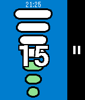

<!-- Generated by scripts/update_app_directory.py: do not edit by hand -->
[← All Pebble Developers](../developers.md)

# lordlouis

*1 app · Last updated 2026-10-11 · [About these lists](../about-app-lists.md)*

Links: [Pebble App Store](https://apps.repebble.com/apps/dev/lordlouis_5633e55cd2dcf1dd22000007) · [GitHub (lordlouis)](https://github.com/lordlouis)

<h2 class="app-name" id="app-5681f92a94ffb20cb4000072"><a href="https://apps.repebble.com/5681f92a94ffb20cb4000072">Dolce Gusto Time</a> v1.0</h2>
<a class="app-source" href="https://github.com/lordlouis/dolcegustotime" title="Source code" data-search-exclude>View source</a>

App

Released 2015-12-29 Updated 2015-12-29

Runs on: Round 2, Time 2, Pebble 2 Duo, Pebble 2, Time Round, Time, Classic

The Dolce Gusto Time application helps in the preparation of Dolce Gusto beverages in non-automatic coffee machines preparing the beverage using the level indicated in the capsule. Select the…

