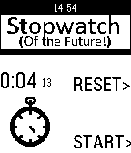
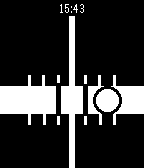

<!-- Generated by scripts/update_app_directory.py: do not edit by hand -->
[← All Pebble Developers](../developers.md)

# Loren Lugosch

*2 apps · Last updated 2026-10-11 · [About these lists](../about-app-lists.md)*

Links: [Pebble App Store](https://apps.repebble.com/apps/dev/loren-lugosch_52c2e955da4287f00c000061) · [GitHub (lorenlugosch)](https://github.com/lorenlugosch)

<button type="button" data-filter="all" aria-pressed="true">All 2</button><button type="button" data-filter="watchface" aria-pressed="false" disabled>Watchfaces 0</button><button type="button" data-filter="watchapp" aria-pressed="false">Apps 2</button>

<label class="dev-sort">Sort by <select><option value="updated">Recently updated</option><option value="released">Newest release</option><option value="title">A–Z</option></select></label>

<h2 class="app-name" id="app-53f7a2aa12a9f1b6bf000263"><a href="https://apps.repebble.com/53f7a2aa12a9f1b6bf000263">Stopwatch!</a> v1.2</h2>
<a class="app-source" href="https://github.com/lorenlugosch/pebble_stopwatch" title="Source code" data-search-exclude>View source</a>

App

Released 2014-08-22 Updated 2016-06-30

Runs on: Time 2, Pebble 2 Duo, Pebble 2, Time, Classic

It&#x27;s a stopwatch- for the future! Very simple stopwatch for your Pebble with a fun animation.

<h2 class="app-name" id="app-53fcf89614ee006f33000004"><a href="https://apps.repebble.com/53fcf89614ee006f33000004">Level for Pebble</a> v1.1</h2>
<a class="app-source" href="http://www.github.com/lorenlugosch/PebbleLevel" title="Source code" data-search-exclude>View source</a>

App

No licence Released 2014-08-26 Updated 2014-08-26

Runs on: Time 2, Pebble 2 Duo, Pebble 2, Time, Classic

Carpentry level using your Pebble! Just choose vertical or horizontal mode using the top button and align the bubble track with the surface you want to level.

