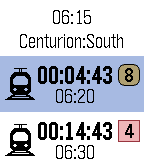

<!-- Generated by scripts/update_app_directory.py: do not edit by hand -->
[← All Pebble Developers](../developers.md)

# Loubser Kotzé

*1 app · Last updated 2026-10-11 · [About these lists](../about-app-lists.md)*

Links: [Rebble App Store](https://apps.rebble.io/en_US/developer/55885afb49c1d18019000109/1)

<h2 class="app-name" id="app-598846a5461a8d1889000af3"><a href="https://apps.rebble.io/en_US/application/598846a5461a8d1889000af3">Gautrain Commuter</a> v1.2</h2>
<a class="app-source" href="https://bitbucket.org/loubser/gautrain-commuter" title="Source code" data-search-exclude>View source</a>

App

Released 2017-08-07 Updated 2017-10-16 Rebble App Store

Runs on: Round 2, Time 2, Pebble 2 Duo, Pebble 2, Time Round, Time, Classic

Gautrain commuters. Tired of just missing the last train or raced to the train station just to find the next train is only departing in 30 minutes? Select your line and station and this app will…

