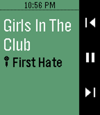

<!-- Generated by scripts/update_app_directory.py: do not edit by hand -->
[← All Pebble Developers](../developers.md)

# lourheroes

*1 app · Last updated 2026-10-12 · [About these lists](../about-app-lists.md)*

Links: [Rebble App Store](https://apps.rebble.io/en_US/developer/5ff3b52a1e6bb11b9eee5c58/1) · [GitHub (lourheroes)](https://github.com/lourheroes)

<h2 class="app-name" id="app-5ff3b52b1e6bb11b9eee5c5a"><a href="https://apps.rebble.io/en_US/application/5ff3b52b1e6bb11b9eee5c5a">Pebblify</a> v0.1</h2>
<a class="app-source" href="https://github.com/lourheroes/pebblify" title="Source code" data-search-exclude>View source</a>

App

Released 2021-01-05 Updated 2021-01-05 Rebble App Store

Runs on: Round 2, Time 2, Pebble 2 Duo, Pebble 2, Time Round, Time, Classic

Pebblify is a full featured Spotify app for your Pebble. Control your Spotify session on any devices, directly from your wrist. Authorize Pebblify to access your Spotify account from the app…

