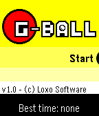

<!-- Generated by scripts/update_app_directory.py: do not edit by hand -->
[← All Pebble Developers](../developers.md)

# Loxo Software

*1 app · Last updated 2026-10-11 · [About these lists](../about-app-lists.md)*

Links: [Rebble App Store](https://apps.rebble.io/en_US/developer/67b2629ed65b830008881646/1) · [GitHub (LoxoSoftware)](https://github.com/LoxoSoftware)

<h2 class="app-name" id="app-67cb281cd2acb301fae26e13"><a href="https://apps.rebble.io/en_US/application/67cb281cd2acb301fae26e13">G-Ball</a> v1.1</h2>
<a class="app-source" href="https://github.com/LoxoSoftware/G-Ball/tree/master" title="Source code" data-search-exclude>View source</a>

App

AGPL-3.0 Released 2025-03-07 Updated 2025-03-18 Rebble App Store

Runs on: Time 2, Time

G-Ball is an action game where you move the ball by tilting your Pebble. Advance trough the levels and avoid dangers, all by tilting your wrist! Submitted for the Rebble Hackathon #002

