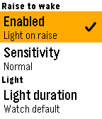

<!-- Generated by scripts/update_app_directory.py: do not edit by hand -->
[← All Pebble Developers](../developers.md)

# Lucaboox

*1 app · Last updated 2026-10-11 · [About these lists](../about-app-lists.md)*

Links: [Pebble App Store](https://apps.repebble.com/apps/dev/lucaboox_3baa3c53d5e0047df0dc5890) · [GitHub (lucaboox)](https://github.com/lucaboox)

<h2 class="app-name" id="app-9b20c579b0344422ab8ea24e"><a href="https://apps.repebble.com/9b20c579b0344422ab8ea24e">Raise to Wake</a> v1.2.0</h2>
<a class="app-source" href="https://github.com/lucaboox/pebble-raise-to-wake" title="Source code" data-search-exclude>View source</a>

App

Released 2026-10-07 Updated 2026-10-10

Runs on: Round 2, Time 2, Pebble 2 Duo, Pebble 2, Time Round, Time, Classic

Raise to wake app that allows the pebble backlight to turn on when you raise your wrist and turn off when lowered.

