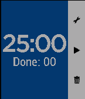

<!-- Generated by scripts/update_app_directory.py: do not edit by hand -->
[← All Pebble Developers](../developers.md)

# Lucas Conceição

*1 app · Last updated 2026-10-12 · [About these lists](../about-app-lists.md)*

Links: [Pebble App Store](https://apps.repebble.com/apps/dev/lucas-concei-o_557f12233c562e59ad00004f) · [GitHub (kalangaum)](https://github.com/kalangaum) · [Website (lucasconceicao.com)](http://lucasconceicao.com)

<h2 class="app-name" id="app-558643b1f14558aa57000089"><a href="https://apps.repebble.com/558643b1f14558aa57000089">POMO D&#x27;ORO</a> v1.3</h2>
<a class="app-source" href="https://github.com/kalangaum/pomopebble" title="Source code" data-search-exclude>View source</a>

App

Released 2015-06-21 Updated 2015-07-02

Runs on: Time 2, Time

Make yourself more productive. Use a pomodoro timer on your wrist with Pomo D&#x27;oro for Pebble Time. You dont need to set alarms on your phone or install apps on your computer. The watch will…

