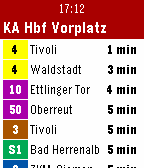

<!-- Generated by scripts/update_app_directory.py: do not edit by hand -->
[← All Pebble Developers](../developers.md)

# luchs

*1 app · Last updated 2026-10-11 · [About these lists](../about-app-lists.md)*

Links: [Pebble App Store](https://apps.repebble.com/apps/dev/luchs_52b95f465dfb6e5b61000058) · [GitHub (lluchs)](https://github.com/lluchs)

<h2 class="app-name" id="app-52bb592c530bf4dc60000018"><a href="https://apps.repebble.com/52bb592c530bf4dc60000018">KVV.live</a> v2.3</h2>
<a class="app-source" href="https://github.com/lluchs/kvv.live" title="Source code" data-search-exclude>View source</a>

App

Released 2013-12-25 Updated 2016-12-13

Runs on: Time 2, Pebble 2 Duo, Pebble 2, Time, Classic

Shows live departure data from Karlsruhe&#x27;s public transit (KVV). Configure your frequented stops on the phone, then view departure information on Pebble. Data is taken from live.kvv.de Deutsch…

