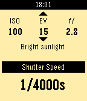

<!-- Generated by scripts/update_app_directory.py: do not edit by hand -->
[← All Pebble Developers](../developers.md)

# Luis Bento

*1 watchface and 1 app · Last updated 2026-10-11 · [About these lists](../about-app-lists.md)*

Links: [Pebble App Store](https://apps.repebble.com/apps/dev/luis-bento_565bbec27b470d0e550000c7) · [GitHub (lfhbento)](https://github.com/lfhbento)

<button type="button" data-filter="all" aria-pressed="true">All 2</button><button type="button" data-filter="watchface" aria-pressed="false">Watchfaces 1</button><button type="button" data-filter="watchapp" aria-pressed="false">Apps 1</button>

<label class="dev-sort">Sort by <select><option value="updated">Recently updated</option><option value="released">Newest release</option><option value="title">A–Z</option></select></label>

<h2 class="app-name" id="app-56b7c014ff7746c5af00003a"><a href="https://apps.repebble.com/56b7c014ff7746c5af00003a">Timeboxed</a> v5.9</h2>
<a class="app-source" href="https://github.com/lfhbento/timeboxed-watchface" title="Source code" data-search-exclude>View source</a>

Watchface

Released 2016-02-07 Updated 2018-02-17

Runs on: Round 2, Time 2, Pebble 2 Duo, Pebble 2, Time Round, Time, Classic

Simple and clean fully customizable watchface with weather data and additional timezone. Key features: * Customize colors * Choose between 8 different fonts * Select text alignment * Display…

<h2 class="app-name" id="app-569d89a7c7fdf7761b000011"><a href="https://apps.repebble.com/569d89a7c7fdf7761b000011">Exposure Calculator</a> v0.1</h2>
<a class="app-source" href="https://github.com/lfhbento/ExposureCalc" title="Source code" data-search-exclude>View source</a>

App

Released 2016-01-19 Updated 2016-01-19

Runs on: Round 2, Time 2, Pebble 2 Duo, Pebble 2, Time Round, Time, Classic

For film camera lovers without a light meter handy, you can just use your watch! Calculate shutter speed based on ISO, aperture and EV. Use the select button to switch between ISO, EV and…

