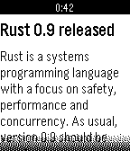

<!-- Generated by scripts/update_app_directory.py: do not edit by hand -->
[← All Pebble Developers](../developers.md)

# Luis Iván Cuende

*2 apps · Last updated 2026-10-12 · [About these lists](../about-app-lists.md)*

Links: [Pebble App Store](https://apps.repebble.com/apps/dev/luis-iv-n-cuende_52cf3390826be30738000002) · [GitHub (luisivan)](https://github.com/luisivan)

<button type="button" data-filter="all" aria-pressed="true">All 2</button><button type="button" data-filter="watchface" aria-pressed="false" disabled>Watchfaces 0</button><button type="button" data-filter="watchapp" aria-pressed="false">Apps 2</button>

<label class="dev-sort">Sort by <select><option value="updated">Recently updated</option><option value="released">Newest release</option><option value="title">A–Z</option></select></label>

<h2 class="app-name" id="app-52cf3a634680afd4ff000003"><a href="https://apps.repebble.com/52cf3a634680afd4ff000003">Hacker News</a> v1.0.0</h2>
<a class="app-source" href="https://github.com/luisivan/pebble-hn" title="Source code" data-search-exclude>View source</a>

App

Released 2014-01-10 Updated 2025-11-25

Runs on: Time 2, Pebble 2 Duo, Pebble 2, Time, Classic

Now you can read YCombinator Hacker News from your wrist! This app lets you read a summary of the 30 top news, but more features are coming soon, such as read later or an option to read the whole…

<h2 class="app-name" id="app-52ee43b994cc96bd0b00000c"><a href="https://apps.repebble.com/52ee43b994cc96bd0b00000c">Slides</a> v1.0.0</h2>
<a class="app-source" href="https://github.com/luisivan/pebble-slides" title="Source code" data-search-exclude>View source</a>

App

Released 2014-02-02 Updated 2014-02-02

Runs on: Time 2, Pebble 2 Duo, Pebble 2, Time, Classic

Pebble app to toggle slides on Linux, Mac and Windows, includes chronometer and notes to make giving talks easier. The app displays a chronometer and you can go back/forth in your slides using the…

