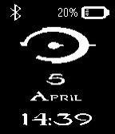

<!-- Generated by scripts/update_app_directory.py: do not edit by hand -->
[← All Pebble Developers](../developers.md)

# Luis Miguel Sierra

*1 watchface · Last updated 2026-10-11 · [About these lists](../about-app-lists.md)*

Links: [Pebble App Store](https://apps.repebble.com/apps/dev/luis-miguel-sierra_532ec3204e66a6500300012d) · [GitHub (lmsierra)](https://github.com/lmsierra)

<h2 class="app-name" id="app-533ffab3b8a7e587d2000322"><a href="https://apps.repebble.com/533ffab3b8a7e587d2000322">Halo</a> v1.1.1</h2>
<a class="app-source" href="https://github.com/lmsierra/Halo-Watchface/tree/master" title="Source code" data-search-exclude>View source</a>

Watchface

Released 2014-04-05 Updated 2015-01-09

Runs on: Time 2, Pebble 2 Duo, Pebble 2, Time, Classic

Halo watchface (Halo logo and font) with bluetooth connection, battery state (image and percentage), time (24 hours), day and month. Bluetooth image not visible while it is not connected. Invert…

