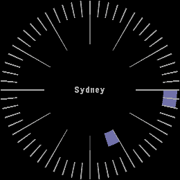

<!-- Generated by scripts/update_app_directory.py: do not edit by hand -->
[← All Pebble Developers](../developers.md)

# Luit

*1 watchface · Last updated 2026-10-11 · [About these lists](../about-app-lists.md)*

Links: [Pebble App Store](https://apps.repebble.com/apps/dev/luit_b2364dbffae18922dc4ab29d) · [GitHub (Luit)](https://github.com/Luit)

<h2 class="app-name" id="app-c42b7312c12847609789a28c"><a href="https://apps.repebble.com/c42b7312c12847609789a28c">It&#x27;s five o&#x27;clock somewhere</a> v0.1</h2>
<a class="app-source" href="https://github.com/Luit/five-somewhere" title="Source code" data-search-exclude>View source</a>

Watchface

No licence Released 2026-04-19 Updated 2026-04-19

Runs on: Round 2

A watchface that always shows five o&#x27;clock.

