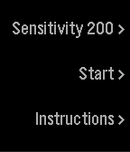

<!-- Generated by scripts/update_app_directory.py: do not edit by hand -->
[← All Pebble Developers](../developers.md)

# Luke

*1 app · Last updated 2026-10-12 · [About these lists](../about-app-lists.md)*

Links: [Pebble App Store](https://apps.repebble.com/apps/dev/luke_54f77c7693d5fb3ec9000092) · [GitHub (lukewakeford)](https://github.com/lukewakeford) · [Website (twitter.com)](https://twitter.com/lukewakeford)

<h2 class="app-name" id="app-55acda3cd4cc3810e3000062"><a href="https://apps.repebble.com/55acda3cd4cc3810e3000062">Posture</a> v1.2</h2>
<a class="app-source" href="https://github.com/lukewakeford/Posture" title="Source code" data-search-exclude>View source</a>

App

Released 2015-07-20 Updated 2016-03-18

Runs on: Time 2, Pebble 2 Duo, Pebble 2, Time, Classic

Simple watch app that reminds you to sit up straight with scheduled notifications and slouch detection. Hook the watch over your collar and press the start button.

