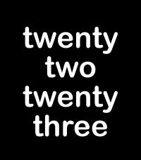

<!-- Generated by scripts/update_app_directory.py: do not edit by hand -->
[← All Pebble Developers](../developers.md)

# M T

*1 app · Last updated 2026-10-11 · [About these lists](../about-app-lists.md)*

Links: [Pebble App Store](https://apps.repebble.com/apps/dev/m-t_bd702c101c8cc5e7be72747d) · [GitHub (michft)](https://github.com/michft)

<h2 class="app-name" id="app-384b30aa3eeb468ba63a4f7e"><a href="https://apps.repebble.com/384b30aa3eeb468ba63a4f7e">Pill Reminder</a> v0.2.14</h2>
<a class="app-source" href="https://github.com/michft/pebble-watch-pills" title="Source code" data-search-exclude>View source</a>

App

Released 2026-07-21 Updated 2026-09-17

Runs on: Time 2

App to remind me to take my pills and track when I do.

