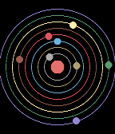

<!-- Generated by scripts/update_app_directory.py: do not edit by hand -->
[← All Pebble Developers](../developers.md)

# m1k

*3 watchfaces · Last updated 2026-10-12 · [About these lists](../about-app-lists.md)*

Links: [Rebble App Store](https://apps.rebble.io/en_US/developer/67c9fbda899ef10009ea6864/1) · [GitHub (less-ly)](https://github.com/less-ly)

<button type="button" data-filter="all" aria-pressed="true">All 3</button><button type="button" data-filter="watchface" aria-pressed="false">Watchfaces 3</button><button type="button" data-filter="watchapp" aria-pressed="false" disabled>Apps 0</button>

<label class="dev-sort">Sort by <select><option value="updated">Recently updated</option><option value="released">Newest release</option><option value="title">A–Z</option></select></label>

<h2 class="app-name" id="app-67cd0e8ed2acb302d5ba821f"><a href="https://apps.rebble.io/en_US/application/67cd0e8ed2acb302d5ba821f">S4W</a> v1.0</h2>
<a class="app-source" href="https://github.com/less-ly/s4w" title="Source code" data-search-exclude>View source</a>

Watchface

Released 2025-03-09 Updated 2025-03-09 Rebble App Store

Runs on: Round 2, Time 2, Time Round, Time

Simple Solar System Simulation Watchface. Heliocentric and persistent. The simulation that runs, if you so choose, locally on your smartwatch is updated on a daily basis. With actual astronomical…

<h2 class="app-name" id="app-67ca03d5b7a023018e36ffb0"><a href="https://apps.rebble.io/en_US/application/67ca03d5b7a023018e36ffb0">Orbital RE</a> v1.2</h2>
<a class="app-source" href="https://github.com/less-ly/orbital_re" title="Source code" data-search-exclude>View source</a>

Watchface

Released 2025-03-06 Updated 2025-03-08 Rebble App Store

Runs on: Round 2, Time 2, Time Round, Time

Reverse engineered from Orbital watchface by Software Logix LLC. Original description: &quot; An elegant watch face featuring planets orbiting as the watch hands. The outer planet is represents to…

<h2 class="app-name" id="app-67cb10b7d2acb301fae26e0d"><a href="https://apps.rebble.io/en_US/application/67cb10b7d2acb301fae26e0d">Time Left</a> v1.0</h2>
<a class="app-source" href="https://github.com/less-ly/time_left" title="Source code" data-search-exclude>View source</a>

Watchface

Released 2025-03-07 Updated 2025-03-07 Rebble App Store

Runs on: Round 2, Time 2, Time Round, Time

in hours.

