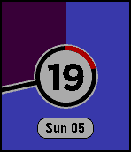

<!-- Generated by scripts/update_app_directory.py: do not edit by hand -->
[← All Pebble Developers](../developers.md)

# m3tropolis

*1 watchface · Last updated 2026-10-12 · [About these lists](../about-app-lists.md)*

Links: [Pebble App Store](https://apps.repebble.com/apps/dev/m3tropolis_52e9b4164703a74a67000039) · [GitHub (tdsbtoes)](https://github.com/tdsbtoes)

<h2 class="app-name" id="app-558782c83ae5e507fc000081"><a href="https://apps.repebble.com/558782c83ae5e507fc000081">Old Fogies Can&#x27;t See Worth S***</a> v1.91</h2>
<a class="app-source" href="https://github.com/tdsbtoes/OldFogies" title="Source code" data-search-exclude>View source</a>

Watchface

Released 2015-06-22 Updated 2017-02-27

Runs on: Round 2, Time 2, Time Round, Time

Idea influenced from &quot;ChromaTick&quot;, and modified from the &quot;KS Clock Face&quot; code. As my eyesight is getting steadily worse, I wanted a watch face I could easily read. A big digital readout would be…

