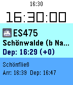
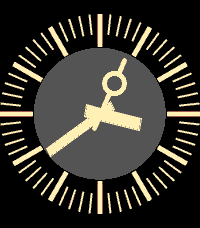
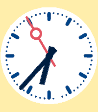
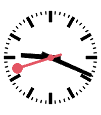
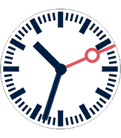

<!-- Generated by scripts/update_app_directory.py: do not edit by hand -->
[← All Pebble Developers](../developers.md)

# Maartje Eyskens

*4 watchfaces and 1 app · Last updated 2026-10-11 · [About these lists](../about-app-lists.md)*

Links: [Pebble App Store](https://apps.repebble.com/apps/dev/maartje-eyskens_34c02825342440b7eebba982) · [GitHub (meyskens)](https://github.com/meyskens)

<button type="button" data-filter="all" aria-pressed="true">All 5</button><button type="button" data-filter="watchface" aria-pressed="false">Watchfaces 4</button><button type="button" data-filter="watchapp" aria-pressed="false">Apps 1</button>

<label class="dev-sort">Sort by <select><option value="updated">Recently updated</option><option value="released">Newest release</option><option value="title">A–Z</option></select></label>

<h2 class="app-name" id="app-08e04f5944424a97977d9f57"><a href="https://apps.repebble.com/08e04f5944424a97977d9f57">PebbleConduct - Pebble App For Train Conductors</a> v1.0.5</h2>
<a class="app-source" href="https://github.com/meyskens/PebbleConduct" title="Source code" data-search-exclude>View source</a>

App

Released 2026-05-24 Updated 2026-06-29

Runs on: Round 2, Time 2, Pebble 2 Duo, Pebble 2, Time Round, Time, Classic

PebbleConduct is a Pebble watch app designed with professional train use in mind. It will provide you real time information about your train wherever you are.

<h2 class="app-name" id="app-13844dc2e66043b6b56e7f15"><a href="https://apps.repebble.com/13844dc2e66043b6b56e7f15">CadranGrandeVitesse</a> v1.0.0</h2>
<a class="app-source" href="https://github.com/meyskens/CadranGrandVitesse" title="Source code" data-search-exclude>View source</a>

Watchface

Released 2026-05-30 Updated 2026-05-30

Runs on: Round 2, Time 2, Pebble 2 Duo, Pebble 2, Time Round, Time, Classic

placeholder

<h2 class="app-name" id="app-732b47b6dd6d4c4d85d14726"><a href="https://apps.repebble.com/732b47b6dd6d4c4d85d14726">ProTime Watchface</a> v1.0.4</h2>
<a class="app-source" href="https://github.com/meyskens/ProTime" title="Source code" data-search-exclude>View source</a>

Watchface

Released 2026-05-27 Updated 2026-05-29

Runs on: Round 2, Time 2, Pebble 2 Duo, Pebble 2, Time Round, Time, Classic

Beste Reizigers, het is 16:26 en u bevind zich op de readme van de ProTime Watchface voor Pebble.

<h2 class="app-name" id="app-638e4d5832de4b16885ab825"><a href="https://apps.repebble.com/638e4d5832de4b16885ab825">ModernSwiss</a> v1.0.1</h2>
<a class="app-source" href="https://github.com/meyskens/ModernSwiss" title="Source code" data-search-exclude>View source</a>

Watchface · <a href="https://forum.rebble.io/t/1001" title="Discuss this app on the Rebble forum" data-search-exclude>Forum thread</a>

Released 2026-05-25 Updated 2026-05-29

Runs on: Round 2, Time 2, Pebble 2 Duo, Pebble 2, Time Round, Time, Classic

Inspired by the simple design of Official Swiss Railways Watch.

<h2 class="app-name" id="app-bb596e1c5474439b96017a1f"><a href="https://apps.repebble.com/bb596e1c5474439b96017a1f">Bahnuhr</a> v1.0.1</h2>
<a class="app-source" href="https://github.com/meyskens/Bahnuhr" title="Source code" data-search-exclude>View source</a>

Watchface

Released 2026-05-29 Updated 2026-05-29

Runs on: Round 2, Time 2, Pebble 2 Duo, Pebble 2, Time Round, Time, Classic

placeholder

