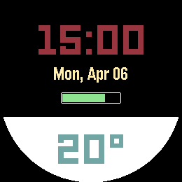
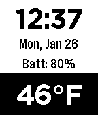

<!-- Generated by scripts/update_app_directory.py: do not edit by hand -->
[← All Pebble Developers](../developers.md)

# MacBoy\_\_Pro

*2 watchfaces · Last updated 2026-10-11 · [About these lists](../about-app-lists.md)*

Links: [Pebble App Store](https://apps.repebble.com/apps/dev/macboy-pro_324802dade0f07d315ed355c) · [GitHub (MacBoyPro98)](https://github.com/MacBoyPro98) · [Website (twitter.com)](https://twitter.com/MacBoy__Pro)

<button type="button" data-filter="all" aria-pressed="true">All 2</button><button type="button" data-filter="watchface" aria-pressed="false">Watchfaces 2</button><button type="button" data-filter="watchapp" aria-pressed="false" disabled>Apps 0</button>

<label class="dev-sort">Sort by <select><option value="updated">Recently updated</option><option value="released">Newest release</option><option value="title">A–Z</option></select></label>

<h2 class="app-name" id="app-ed184324553e4ce2aa6be736"><a href="https://apps.repebble.com/ed184324553e4ce2aa6be736">Pebble Drive</a> v1.6</h2>
<a class="app-source" href="https://github.com/MacBoyPro98/DriveV2" title="Source code" data-search-exclude>View source</a>

Watchface

No licence Released 2026-04-04 Updated 2026-04-07

Runs on: Round 2, Time 2, Pebble 2 Duo, Pebble 2, Time Round, Time, Classic

Basic watch face with time, date, battery percentage and temperature displayed.

<h2 class="app-name" id="app-536b1e7362917afde20000ed"><a href="https://apps.repebble.com/536b1e7362917afde20000ed">Pebble Drive</a> v1.18</h2>
<a class="app-source" href="https://github.com/MacBoyPro98/Pebble.git" title="Source code" data-search-exclude>View source</a>

Watchface

No licence Released 2014-05-08 Updated 2015-10-26

Runs on: Time 2, Pebble 2 Duo, Pebble 2, Time, Classic

Basic Watchface with weather, date, time, and location displayed easily. If you have any suggestions or things I could do differently feel free to contact me with your ideas. With my app on iPhone…

