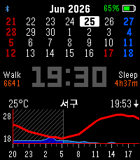

<!-- Generated by scripts/update_app_directory.py: do not edit by hand -->
[← All Pebble Developers](../developers.md)

# Mack Kang

*1 watchface · Last updated 2026-10-11 · [About these lists](../about-app-lists.md)*

Links: [Rebble App Store](https://apps.rebble.io/en_US/developer/5b7a6ad64ea12200016c0152/1) · [GitHub (mackerel-kang)](https://github.com/mackerel-kang)

<h2 class="app-name" id="app-6a3d0e695961b6000961c58c"><a href="https://apps.rebble.io/en_US/application/6a3d0e695961b6000961c58c">ForecasWatchface2-Kor</a> v1.0.0</h2>
<a class="app-source" href="https://github.com/mackerel-kang/forecaswatch2" title="Source code" data-search-exclude>View source</a>

Watchface · <a href="https://forum.rebble.io/t/1084" title="Discuss this app on the Rebble forum" data-search-exclude>Forum thread</a>

Released 2026-06-25 Updated 2026-06-25 Rebble App Store

Runs on: Time 2, Pebble 2 Duo, Pebble 2, Time, Classic

FCW-K puts your day on one screen: an hourly weather forecast graph, a four-week calendar with Korean public holidays, and your key stats — time, battery, steps, and sleep. A Korean-localized fork…

