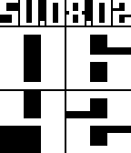

<!-- Generated by scripts/update_app_directory.py: do not edit by hand -->
[← All Pebble Developers](../developers.md)

# MagmaStone

*2 watchfaces and 1 app · Last updated 2026-10-12 · [About these lists](../about-app-lists.md)*

Links: [Pebble App Store](https://apps.repebble.com/apps/dev/magmastone_52ee9e7ebf4b6279c500003f) · [GitHub (magmapus)](https://github.com/magmapus) · [GitHub (magmastonealex)](https://github.com/magmastonealex)

<button type="button" data-filter="all" aria-pressed="true">All 3</button><button type="button" data-filter="watchface" aria-pressed="false">Watchfaces 2</button><button type="button" data-filter="watchapp" aria-pressed="false">Apps 1</button>

<label class="dev-sort">Sort by <select><option value="updated">Recently updated</option><option value="released">Newest release</option><option value="title">A–Z</option></select></label>

<h2 class="app-name" id="app-55578d41809acd6f1a000008"><a href="https://apps.repebble.com/55578d41809acd6f1a000008">Dotface</a> v1.0</h2>
<a class="app-source" href="http://github.com/magmastonealex/dotface" title="Source code" data-search-exclude>View source</a>

Watchface

Apache-2.0 Released 2015-05-16 Updated 2015-05-16

Runs on: Time 2, Pebble 2 Duo, Pebble 2, Time, Classic

A minimalist face with just an hour dot and solid minute hand. Highly configurable, including hour markings, a face circle, and inversion. Designed by Reddit user /u/AchillesPDX!

<h2 class="app-name" id="app-54d7f4915e8d874386000025"><a href="https://apps.repebble.com/54d7f4915e8d874386000025">BIG Date</a> v1.0</h2>
<a class="app-source" href="http://github.com/magmapus/bigdate" title="Source code" data-search-exclude>View source</a>

Watchface

Apache-2.0 Released 2015-02-08 Updated 2015-02-08

Runs on: Time 2, Pebble 2 Duo, Pebble 2, Time, Classic

This is very similar to the BIG watchface, but with the addition of the date at the top! Many thanks to Simon Lee for the art assets and design!

<h2 class="app-name" id="app-53ef6efd11cff6b7bd0000f7"><a href="https://apps.repebble.com/53ef6efd11cff6b7bd0000f7">Flashcards</a> v1.3</h2>
<a class="app-source" href="https://github.com/magmapus/Flashcards" title="Source code" data-search-exclude>View source</a>

App

Released 2014-08-16 Updated 2014-08-18

Runs on: Time 2, Pebble 2 Duo, Pebble 2, Time, Classic

Flashcards lets you quiz yourself on the go! Have an upcoming test? Study on the way! Have a debate? Review your talking points. You can add all the questions and answers you want in the…

