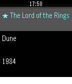

<!-- Generated by scripts/update_app_directory.py: do not edit by hand -->
[← All Pebble Developers](../developers.md)

# Magnetz

*1 app · Last updated 2026-10-11 · [About these lists](../about-app-lists.md)*

Links: [Pebble App Store](https://apps.repebble.com/apps/dev/magnetz_b84c6e02d47a15db36677f7e) · [GitHub (magnetz)](https://github.com/magnetz)

<h2 class="app-name" id="app-651226388f4f4e8989e1f1f2"><a href="https://apps.repebble.com/651226388f4f4e8989e1f1f2">TimeReader</a> v1.1.0</h2>
<a class="app-source" href="https://github.com/magnetz/timereader-pebble" title="Source code" data-search-exclude>View source</a>

App

Released 2026-08-27 Updated 2026-08-27

Runs on: Time 2, Time

Reading stopwatch: time each session, track pages/hour and ETA.

