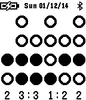

<!-- Generated by scripts/update_app_directory.py: do not edit by hand -->
[← All Pebble Developers](../developers.md)

# Maigard

*1 watchface · Last updated 2026-10-12 · [About these lists](../about-app-lists.md)*

Links: [Pebble App Store](https://apps.repebble.com/apps/dev/maigard_52ce336fcc12acd6bc000028) · [GitHub (Maigard)](https://github.com/Maigard)

<h2 class="app-name" id="app-52ce39fe5013b0bffa000037"><a href="https://apps.repebble.com/52ce39fe5013b0bffa000037">Binary Clock</a> v1.1.0</h2>
<a class="app-source" href="https://github.com/Maigard/Binary-Clock" title="Source code" data-search-exclude>View source</a>

Watchface

No licence Released 2014-01-09 Updated 2014-01-20

Runs on: Time 2, Pebble 2 Duo, Pebble 2, Time, Classic

A watchface that displays the time in binary dots. It includes configuration options to display a status bar including date and a decimal digit display to help learn how to read binary

