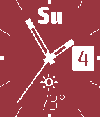

<!-- Generated by scripts/update_app_directory.py: do not edit by hand -->
[← All Pebble Developers](../developers.md)

# Maksym Motornyy

*3 watchfaces · Last updated 2026-10-12 · [About these lists](../about-app-lists.md)*

Links: [Pebble App Store](https://apps.repebble.com/apps/dev/maksym-motornyy_547fe1aac30d374b01000111) · [GitHub (mmotorny)](https://github.com/mmotorny) · [Website (motornyy.com)](http://www.motornyy.com/)

<button type="button" data-filter="all" aria-pressed="true">All 3</button><button type="button" data-filter="watchface" aria-pressed="false">Watchfaces 3</button><button type="button" data-filter="watchapp" aria-pressed="false" disabled>Apps 0</button>

<label class="dev-sort">Sort by <select><option value="updated">Recently updated</option><option value="released">Newest release</option><option value="title">A–Z</option></select></label>

<h2 class="app-name" id="app-54c48bc9f77738e4530000c6"><a href="https://apps.repebble.com/54c48bc9f77738e4530000c6">Motornyy Purist</a> v2.0</h2>
<a class="app-source" href="https://github.com/mmotorny/motornyy-purist" title="Source code" data-search-exclude>View source</a>

Watchface

Released 2015-01-25 Updated 2015-05-24

Runs on: Time 2, Pebble 2 Duo, Pebble 2, Time, Classic

A clean and feature-rich analog watchface. Now supports Pebble Time. Date and time: - day of week; - day of month; - seconds hand (configurable). Weather: - temperature in °C and °F…

<h2 class="app-name" id="app-54853108075d4ce85f00001a"><a href="https://apps.repebble.com/54853108075d4ce85f00001a">Motornyy Progress</a> v1.1</h2>
<a class="app-source" href="https://github.com/mmotorny/motornyy-progress" title="Source code" data-search-exclude>View source</a>

Watchface

Released 2014-12-08 Updated 2014-12-22

Runs on: Time 2, Pebble 2 Duo, Pebble 2, Time, Classic

A minimalistic digital watchface enhanced by analog intuition: numbers move from left to right as they increase.

<h2 class="app-name" id="app-548d64806bfc313060000095"><a href="https://apps.repebble.com/548d64806bfc313060000095">Motornyy Bad</a> v1.0</h2>
<a class="app-source" href="https://github.com/mmotorny/motornyy-bad" title="Source code" data-search-exclude>View source</a>

Watchface

Released 2014-12-14 Updated 2014-12-14

Runs on: Time 2, Pebble 2 Duo, Pebble 2, Time, Classic

A Breaking Bad poster reimagined as a watchface.

