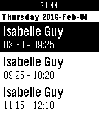

<!-- Generated by scripts/update_app_directory.py: do not edit by hand -->
[← All Pebble Developers](../developers.md)

# Malp

*1 app · Last updated 2026-10-11 · [About these lists](../about-app-lists.md)*

Links: [Pebble App Store](https://apps.repebble.com/apps/dev/malp_55b276c33dcdb0c7c5000069) · [GitHub (Malpp)](https://github.com/Malpp)

<h2 class="app-name" id="app-56b40e11ed001b5bc6000051"><a href="https://apps.repebble.com/56b40e11ed001b5bc6000051">SLC Omnivox Cancelled Classes</a> v1.1</h2>
<a class="app-source" href="https://github.com/Malpp/SLC" title="Source code" data-search-exclude>View source</a>

App

No licence Released 2016-02-05 Updated 2016-02-09

Runs on: Time 2, Pebble 2 Duo, Pebble 2, Time, Classic

This app looks up which classes have been canceled on Omnivox. This is made for the St.Laurence College Omnivox.

