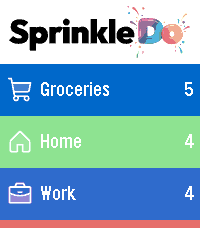
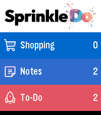

<!-- Generated by scripts/update_app_directory.py: do not edit by hand -->
[← All Pebble Developers](../developers.md)

# Malte Makes

*2 apps · Last updated 2026-10-11 · [About these lists](../about-app-lists.md)*

Links: [Pebble App Store](https://apps.repebble.com/apps/dev/malte-makes_896e5405c93e19ac03f3c392)

<button type="button" data-filter="all" aria-pressed="true">All 2</button><button type="button" data-filter="watchface" aria-pressed="false" disabled>Watchfaces 0</button><button type="button" data-filter="watchapp" aria-pressed="false">Apps 2</button>

<label class="dev-sort">Sort by <select><option value="updated">Recently updated</option><option value="released">Newest release</option><option value="title">A–Z</option></select></label>

<h2 class="app-name" id="app-766a729db7134e859e889565"><a href="https://apps.repebble.com/766a729db7134e859e889565">Sprinkle Do</a> v1.24.22</h2>
<a class="app-source" href="https://sprinkledo.com" title="Source code" data-search-exclude>View source</a>

App

Released 2026-09-27 Updated 2026-10-08

Runs on: Round 2, Time 2

Sprinkle Do is your shopping lists and to-dos, right on your wrist. Browse your sections at a glance, check off shopping items with a single tap, and add new tasks by voice - all synced live with…

<h2 class="app-name" id="app-f0119ffb67fe47d38d1097f6"><a href="https://apps.repebble.com/f0119ffb67fe47d38d1097f6">Sprinkle Do Local</a> v1.0.0</h2>
<a class="app-source" href="https://sprinkledo.com" title="Source code" data-search-exclude>View source</a>

App

Released 2026-09-27 Updated 2026-09-27

Runs on: Round 2, Time 2

A free, no-account trial of Sprinkle Do that runs entirely on your watch. Three ready-made lists - Shopping, Notes, To-Do - add items by voice, tap to check them off. Nothing syncs anywhere…

