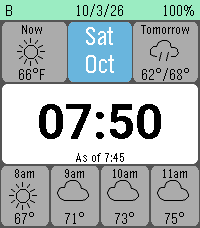

<!-- Generated by scripts/update_app_directory.py: do not edit by hand -->
[← All Pebble Developers](../developers.md)

# Manapart

*1 watchface · Last updated 2026-10-11 · [About these lists](../about-app-lists.md)*

Links: [Pebble App Store](https://apps.repebble.com/apps/dev/manapart_22c084cbc96fe0b713c630c1) · [GitHub (ManApart)](https://github.com/ManApart)

<h2 class="app-name" id="app-9492f2777b5f422e90454147"><a href="https://apps.repebble.com/9492f2777b5f422e90454147">Weather Glance</a> v1.0.3</h2>
<a class="app-source" href="https://github.com/ManApart/manapart-watchface" title="Source code" data-search-exclude>View source</a>

Watchface

No licence Released 2026-10-03 Updated 2026-10-08

Runs on: Time 2

Designed to be glancable for time, or inspected for more information. Includes both date/day names and a full date for those forgetful of the day/month. - Weather from Open-Meteo, no API Key…

