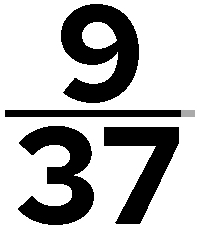

<!-- Generated by scripts/update_app_directory.py: do not edit by hand -->
[← All Pebble Developers](../developers.md)

# Mangla &amp; Co LLC

*1 watchface · Last updated 2026-10-11 · [About these lists](../about-app-lists.md)*

Links: [Rebble App Store](https://apps.rebble.io/en_US/developer/6a5a2343c423ad0008ec9370/1) · [GitHub (moeed80)](https://github.com/moeed80) · [Website (moeed.com)](https://moeed.com)

<h2 class="app-name" id="app-6a5a328955030a00092d829f"><a href="https://apps.rebble.io/en_US/application/6a5a328955030a00092d829f">Squintless</a> v1.2.0</h2>
<a class="app-source" href="https://github.com/moeed80/squintless" title="Source code" data-search-exclude>View source</a>

Watchface · <a href="https://forum.rebble.io/t/1164" title="Discuss this app on the Rebble forum" data-search-exclude>Forum thread</a>

Released 2026-07-17 Updated 2026-07-22 Rebble App Store

Runs on: Time 2, Pebble 2 Duo, Pebble 2, Time, Classic

Squintless is an accessibility-first watch face for Pebble Time 2. It exists for one job: let you tell the time instantly. No date. No weather. No step count. No seconds. No icons. No decorative…

