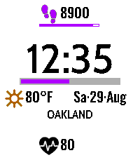

<!-- Generated by scripts/update_app_directory.py: do not edit by hand -->
[← All Pebble Developers](../developers.md)

# Manoj Mehta

*1 watchface · Last updated 2026-10-11 · [About these lists](../about-app-lists.md)*

Links: [Pebble App Store](https://apps.repebble.com/apps/dev/manoj-mehta_49657dd6f957e757c3df4c24) · [GitHub (jhatax)](https://github.com/jhatax)

<h2 class="app-name" id="app-7727666da5c84c259b3a70b3"><a href="https://apps.repebble.com/7727666da5c84c259b3a70b3">At A Glance</a> v1.5.0</h2>
<a class="app-source" href="https://github.com/jhatax/at-a-glance" title="Source code" data-search-exclude>View source</a>

Watchface

Released 2026-07-08 Updated 2026-09-17

Runs on: Round 2, Time 2, Pebble 2 Duo, Pebble 2, Time Round, Time, Classic

__At A Glance__ is a Pebble watch face inspired by cockpit instrumentation. It displays information with minimal interpretation. Time stays dominant. Icons identify. Numbers quantify. Lines show…

