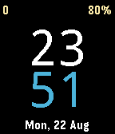

<!-- Generated by scripts/update_app_directory.py: do not edit by hand -->
[← All Pebble Developers](../developers.md)

# Manuel Pedrero

*1 watchface · Last updated 2026-10-12 · [About these lists](../about-app-lists.md)*

Links: [Pebble App Store](https://apps.repebble.com/apps/dev/manuel-pedrero_56f8fead5e4cddf138000024) · [GitHub (mpedrero)](https://github.com/mpedrero)

<h2 class="app-name" id="app-57bb76c7bb85ed1b790005c9"><a href="https://apps.repebble.com/57bb76c7bb85ed1b790005c9">Mere</a> v1.0</h2>
<a class="app-source" href="https://github.com/mpedrero/pebble-mere" title="Source code" data-search-exclude>View source</a>

Watchface

Released 2016-08-22 Updated 2016-08-22

Runs on: Time 2, Pebble 2 Duo, Pebble 2, Time, Classic

A watchface with simplicity and legibility in mind. Inspired in Nucleus. Features: + Big and legible time (12/24 hour) + Date + Steps (upper left) + Battery status (upper right) + Bluetooth alert

