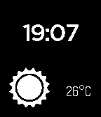

<!-- Generated by scripts/update_app_directory.py: do not edit by hand -->
[← All Pebble Developers](../developers.md)

# Marc-André Dufresne

*1 watchface · Last updated 2026-10-11 · [About these lists](../about-app-lists.md)*

Links: [Pebble App Store](https://apps.repebble.com/apps/dev/marc-andr-dufresne_52cb0dc545ffdd6893000022) · [GitHub (MarcDufresne)](https://github.com/MarcDufresne)

<h2 class="app-name" id="app-52cb11e6b13828dedf00002b"><a href="https://apps.repebble.com/52cb11e6b13828dedf00002b">BetterWeather</a> v1.0</h2>
<a class="app-source" href="https://github.com/MarcDufresne/betterweather-watchface" title="Source code" data-search-exclude>View source</a>

Watchface

No licence Released 2014-01-06 Updated 2014-01-11

Runs on: Time 2, Pebble 2 Duo, Pebble 2, Time, Classic

This watchface displays weather by connecting to the BetterWeather DashClock extension on Android. It will display one of the more than 10 icons available to reflect the current condition and the…

