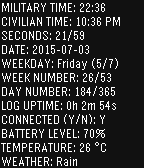

<!-- Generated by scripts/update_app_directory.py: do not edit by hand -->
[← All Pebble Developers](../developers.md)

# Marcello Brivio

*1 watchface · Last updated 2026-10-12 · [About these lists](../about-app-lists.md)*

Links: [Pebble App Store](https://apps.repebble.com/apps/dev/marcello-brivio_5580881261728733a4000055) · [GitHub (marcellobrivio)](https://github.com/marcellobrivio) · [Website (marcellobrivio.com)](http://www.marcellobrivio.com/pebble-verbose-watchface)

<h2 class="app-name" id="app-5597be3a6e32ca686800001e"><a href="https://apps.repebble.com/5597be3a6e32ca686800001e">Verbose Watchface for Pebble</a> v1.30</h2>
<a class="app-source" href="https://github.com/marcellobrivio/Pebble-Verbose-Watchface" title="Source code" data-search-exclude>View source</a>

Watchface

Released 2015-07-04 Updated 2016-02-27

Runs on: Time 2, Pebble 2 Duo, Pebble 2, Time, Classic

In this watchface you won&#x27;t find beautiful graphics or cool typography to please your eyes: only data, displayed with a terminal-inspired look &amp; feel for the little nerd living inside everyone of…

